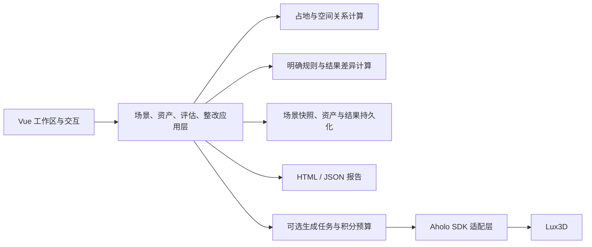

> 历史方案：本页保留早期交接内容，当前开发以 [V6.1 总体方案](v6.1/00-overview.md) 为准。服务端持久化、在线生成等旧优先级不再指导首版。

# 架构与详细设计整理

技术方向来自[交接摘要](../materials/source/handoff-summary-20261103.txt)：Python 后端，Vue 3 / TypeScript / Three.js 前端，Lux3D 核心资产。当前无参考代码，以下类与方法名称是设计线索；参数、返回值、异常、事务定义需要从原包恢复或另行设计。

## 系统分层

图示为摘要内容的架构整理；数据库、Web 框架、队列与部署方式尚未指定。

## 后端类与方法

| 层级 | 类 | 摘要给出的方法 | 职责 |
| --- | --- | --- | --- |
| 场景应用 | `SceneService` | `create_from_template()`、`get_snapshot()`、`update_object()`、`replace_snapshot()` | 模板创建、对象变更、版本控制和保存 |
| 资产应用 | `AssetService` | `import_manual()`、`import_provider_output()`、`set_calibration()`、`approve()` | 导入、校准、来源核验与入库 |
| 评估应用 | `AssessmentService` | `evaluate()`、`build_context()`、`explain()` | 固定输入快照、执行规则、解释结果 |
| 整改应用 | `RemediationService` | `begin()`、`compare()`、`detect_tradeoffs()` | 比较整改与检测双人群需求冲突 |
| 空间计算 | `FootprintService` | `corners()`、`overlaps()`、`distance()` | 旋转占地边界、相交和距离 |
| 规则 | `RuleEngine`、各规则类 | `evaluate()`、`applies()` | 执行八条明确规则，完整规则定义待补 |
| 差异计算 | `FindingDiffer` | `compare()` | 区分新增问题、条件变化、信息缺失和对象移出范围 |
| SDK 适配 | `AholoSdkGateway` | `create_image_task()`、`retrieve_task()` | 隔离官方 SDK；这些名称是设计中的封装名 |
| 生成任务 | `GenerationService`、`GenerationWorker` | `request()`、`submit()`、`poll()`、`materialize()` | 幂等请求、状态恢复、轮询和结果保存 |
| 积分控制 | `CreditBudgetService` | `reserve()`、`reconcile()` | 内部预留与实际扣分核对 |
| 报告 | `ReportService` | `render_html()`、`render_json()`、`export_public_bundle()` | 导出版本、依据、局限与行动清单 |

## 前端类与方法

| 类 | 摘要给出的方法 | 职责 |
| --- | --- | --- |
| `SceneRuntime` | `mount()`、`setSnapshot()`、`dispose()` | 场景生命周期与快照显示 |
| `AssetLoader` | `load()`、`dispose()` | 模型加载与资源释放 |
| `TransformController` | `beginDrag()`、`commitDrag()` | 拖动事务和提交 |
| `WorkspaceController` | `undo()`、`assess()` | 撤销、保存与重新评估的工作区协调 |
| `FindingOverlay` | `showFinding()` | 高亮相关对象、解释关系 |
| `ComparisonController` | `compareWithCurrent()` | 展示整改前后结果 |

原文按分层列出方法，未提供逐类完整签名；此处前端分配按职责整理，实施前应确认具体归属。

## 数据与一致性要求

| 数据概念 | 从摘要可确定的要求 |
| --- | --- |
| 场景快照 | 评估固定某一版本的输入；不能读取过程中混入之后的编辑 |
| 场景对象 | 稳定对象标识；尺寸与已确认属性独立于视觉资产 |
| 资产 | 来源、校准和批准状态；替换模型不重建业务对象 |
| 评估结果 | 场景版本、输入摘要、规则版本和三态结果 |
| 差异结果 | 记录新增、条件变化、缺失信息或移出范围等原因 |
| 生成任务 | 本地幂等标识、官方任务关联、状态恢复与持久化结果 |
| 预算台账 | 内部预算与实际消费记录分开，不能冒充官方余额 |

摘要称原包含场景/资产 JSON Schema、前端类型与 19 个应用接口操作；这些文件未取得，因此当前文档不提供假定的 Schema、HTTP 路径或线上可调用接口。

## 建议的实施顺序与待定决策

以下为本次整理新增的实施建议，需在工程阶段验证：

1. 先决定坐标系、长度单位、角度单位、模型朝向、原点与占地边界约定，并在前后端统一。
2. 先完成最小持久化闭环：读取快照、校验变更、保存新版本，再加入评估与差异。
3. 为每次评估携带场景版本；前端仅接受与当前目标版本一致的结果，防止乱序覆盖。
4. 把视觉加载失败与计算输入缺失分开呈现；保留已确认的几何数据和未知项。
5. 实现八条规则之前，补齐各自输入、适用条件、阈值、依据、三态判定与边界样例。
6. 最后按真实契约生成应用 OpenAPI 与前端类型；应用接口与供应商 SDK 契约分开维护。

这些建议尚无代码与测试证明，不构成对原详细设计的逐字恢复。

