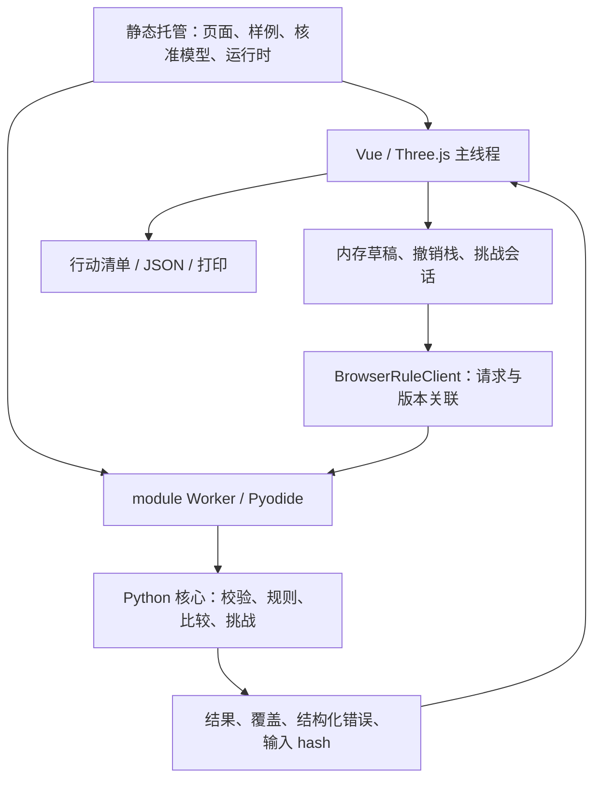

# 架构、数据与契约

V6.1 参考内核、browser-spike、contracts、scripts、tools 和资产规划已导入；apps/web 仍待创建。接口分为可运行参考实现和待建应用层，不能混称完整产品。

## 运行结构



首屏先显示房间和加载反馈，Worker 并行准备。引擎未就绪时允许观察，不显示检查结论或挑战成功。拖动预览不逐帧评估，松开时提交一次校验和重算。

## 目录与职责

| 目录 | 计划职责 |
| --- | --- |
| reference/homesafe_core/ | canonical 模型、八条规则、几何、覆盖、比较与挑战 |
| browser-spike/ | Worker、客户端和诊断；不是完整作品 |
| apps/web/ | 待建正式 Vue / TypeScript / Three.js 工程 |
| contracts/ | 从 Python 模型生成 Schema / TypeScript；HTTP 契约仅供备用路径 |
| assets/public/ | 逐项核准的公共 GLB 与清单 |
| scripts/、tools/ | 本地检查、打包、契约生成及可选 CLI |

## 关键模块

| 模块 | 责任与关键方法 |
| --- | --- |
| SceneRuntime / AssetLoader | mount、快照更新、实例化、校准、资源释放 |
| TransformController | beginDrag、previewTransform、commitDrag、cancelDrag；非法回弹 |
| RoleCameraController | 切换视角、聚焦对象，不修改人体能力 |
| WorkspaceController | 执行操作、撤销、重置、导出内存场景 |
| BrowserRuleClient / EvaluationController | 初始化、超时、请求关联、只接受当前 revision/hash 结果 |
| RuleEngine / SafetyRule | 校验后执行独立规则，不在异常时返回未触发 |
| PlacementValidator | 占地、垂直区间、支撑高度与房间边界 |
| CoverageService / TraitCandidatePolicy | 缺失范围、未知资料及类别候选，每对象汇总资料卡 |
| ComparisonGuard / FindingDiffer | 比较基础、布局/观察变化来源、resolved_unknown |
| ChallengeService / ChallengeController | 白名单移动、目标、计步、撤销、剩余事项 |
| FindingsPresenter / ReportBuilder | 卡片、高亮、覆盖、清单，不解析错误字符串猜对象 |

## 数据与坐标

- 长度以米为单位，Y 向上、XZ 为地面，家具位置为底面中心，yaw 绕 Y。
- 矩形通道 x/z 为中心，width 沿 X、depth 沿 Z；首版只判断指定矩形通道占用。
- SceneObject 具有稳定 ID；视觉资产替换不能悄悄改变确认尺寸、traits 或规则关联。
- 观察值保留 value、source_kind、observed_at、verification_state；未知不填 false。
- Assessment 绑定 input_hash、规则版本、coverage 与比较基础；PlacementIssue 含对象 ID、相关对象、字段、稳定 code 和消息。
- 状态保存在 SceneDraft、CommandHistory、ChallengeSession；默认刷新重置，可下载 JSON。没有云端账户保存承诺。
- 参考设计可读 schema_version=2.0 场景，V6 规则版本为 demo-rules-3.0；恢复 V6.1 后以实际 canonical 模型为准，旧评估结果须重算。

## Worker 协议

参考请求形态：

```json
{"id":17,"op":"evaluate","clientRevision":3,"payload":{"scene":"<canonical Scene>"}}
```

| 操作 | 载荷与行为 |
| --- | --- |
| init | 固定运行时、依赖和 hash 校验的核心包 |
| evaluate | {scene}，完整校验并评估 |
| compare | {before, after}，Python 重算，不信任客户端填写的结论 |
| challenge_start | {scene, movable_ids, goals}，只使用核准样例 |
| challenge_move | {object_id, transform: {position, yaw_rad}} |
| challenge_undo / challenge_reset / challenge_state | 空载荷，使用 Worker 内当前会话 |

响应含请求 id、clientRevision、ok，以及 result/evaluation_ms 或结构化 error。业务 JSON 限 512 KB，V6.1 另要求嵌套不超过 64 层并捕捉递归错误。不接收任意 Python 源码、文件路径或不受控 URL。

client_revision 单调增加，撤销也是新操作；过期响应不能覆盖草稿。版本只用于本地事件关联，不是多人锁。输入 hash 同时约束显示与导出。比较必须使用相同场景、成员、范围、规则与参数基础。

## 恢复约定

初始化失败清理 Promise/状态；用户重试时重建 Worker，移除失败模块缓存、WASM 状态与超时任务。不自动重放旧动作，避免重复计步。超时、Worker 崩溃或校验失败均显示明确不可用/错误状态。
